# Arquitectura de Núcleo — el mapa del sistema

Escrito desde el código, no desde la documentación (Sprint 16, 2026-10-10). Es el
documento del que se dibuja Núcleo entero: cada bloque `mermaid` se importa en Excalidraw
con «Mermaid to Excalidraw».

**Cómo se cita.** Entre comillas invertidas, `ruta/desde/la/raíz` o `ruta#Nombre` (función,
tipo, método `Tipo.Metodo`, constante; en PHP `Clase::metodo`). Nunca números de línea, que se
desfasan solos. `cmd/nucleo/mapa_test.go#TestElMapaNoCitaNadaQueNoExista` lee este fichero y
falla si un fichero, una función, un test o un ADR citado no existe. Los bloques Mermaid usan
nombres cortos y no se comprueban así; su sintaxis se validó con `mermaid.parse` (mermaid 11).

**Lo que este documento no hace**: justificar las decisiones (eso es `docs/adr/`) ni decir qué
garantiza el sistema y qué no (eso es `docs/GARANTIAS.md`).

---

## 1. Componentes

### 1.1 El producto, en una figura

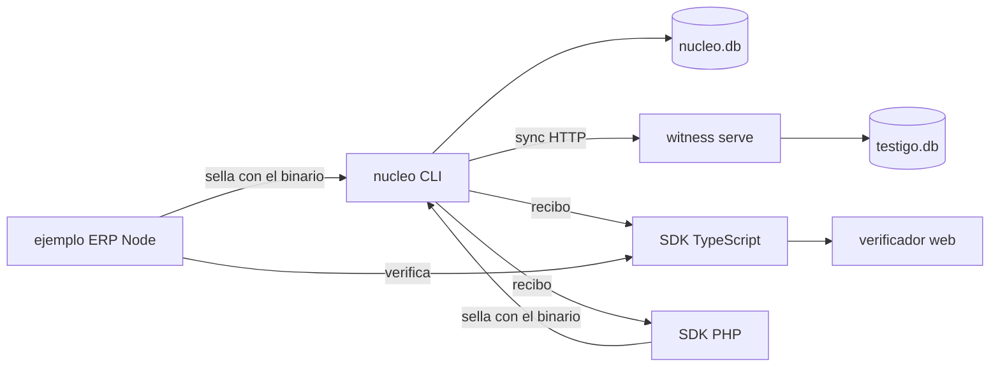

- **La CLI** `nucleo` (`cmd/nucleo/`): un solo binario que crea el ledger, sella, sincroniza
  con testigos, emite recibos, verifica, reconcilia, respalda y restaura, y que también **es**
  el testigo (`witness serve`). La tabla de subcomandos es `cmd/nucleo/main.go#commands`.
- **El ledger** es un fichero SQLite por despliegue, `nucleo.db` (`internal/store/`).
- **El testigo** es otro proceso de la misma CLI, con su propia base y su propia clave
  (`internal/witness/`). Atiende uno o varios logs (ADR-030).
- **Tres verificadores de recibos**, independientes entre sí: el de Go (`internal/receipt/`), el
  SDK de TypeScript (`sdk/ts/src/receipt.ts#verifyReceipt`), que empaquetado es la página
  `web/verify/` (`npm run bundle` en `sdk/ts/package.json`), y el de PHP
  (`sdk/php/src/Verifier.php#Verifier::verify`), escrito desde la especificación.
- **El sellador de PHP** (`sdk/php/src/Sealer.php#Sealer`) no reimplementa nada: ejecuta el
  binario y valida su `--json` (ADR-021).
- **El ejemplo** `examples/erp-node/`: un ERP mínimo que sella con el binario
  (`examples/erp-node/src/nucleo.js#Nucleo`) y verifica con el SDK publicado (ADR-026).
- **El kit del operador del testigo** `deploy/witness/`: unidad de systemd, Caddyfile,
  configuración de ejemplo y guía; lo valida `scripts/valida-kit-testigo.sh`.

### 1.2 Los paquetes de Go y sus imports reales

Sacado con `go list -f '{{.ImportPath}} :: {{join .Imports " "}}'` sobre `./internal/...`,
`./cmd/nucleo` y `./profiles/...`, quedándose con los imports del propio módulo:

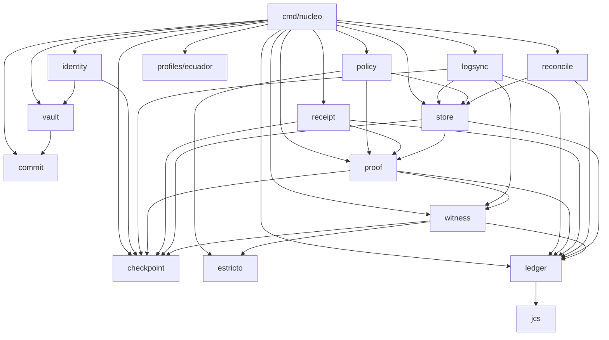

`internal/keys/` e `internal/integration/` no aparecen: el primero no lo importa ningún paquete
del producto (solo `cmd/nucleo-demo/` y los `cmd/nucleo-poc*/` históricos y un benchmark de
`internal/ledger/`), y el segundo solo tiene tests de extremo a extremo.

Dependencias externas, del mismo `go list`: `golang.org/x/mod/sumdb/note` (checkpoint, proof,
witness), `modernc.org/sqlite` (store, witness), `golang.org/x/crypto` —hkdf en commit; argon2 y
chacha20poly1305 en vault—, `github.com/shurlinet/go-slip39` (solo `internal/vault/backup.go`,
ADR-010) y `golang.org/x/term` (cmd/nucleo).

### 1.3 Qué hace cada paquete

| paquete | qué hace | entrada principal |
|---|---|---|
| `internal/jcs/` | canonicalización JSON RFC 8785, con los vectores oficiales | `internal/jcs/jcs.go` |
| `internal/ledger/` | cabecera de bloque, firma Ed25519 sobre su digest, encadenado, regla de hoja `leaf/v2` y Merkle RFC 6962/9162 | `internal/ledger/block.go#Seal`, `internal/ledger/merkle.go#InclusionProof` |
| `internal/checkpoint/` | notas firmadas C2SP, el `Log` que firma checkpoints sin retroceder nunca, y la firma extra ML-DSA-44 (ADR-007) | `internal/checkpoint/log.go#Log.Sign`, `internal/checkpoint/checkpoint.go#Verify` |
| `internal/store/` | el ledger en SQLite: tablas, triggers append-only, verificación al abrir (ADR-016) y escritura atómica del sellado (ADR-020) | `internal/store/store.go#Open`, `internal/store/record.go#Store.AppendRecord` |
| `internal/vault/` | passphrase → Argon2id → KEK → DEK; blobs y secretos cifrados; respaldo SLIP-0039; cambio de passphrase (ADR-029) | `internal/vault/keys.go#Unlock`, `internal/vault/rekey.go#PrepareRekey` |
| `internal/commit/` | compromisos HMAC-SHA-256 con subclave por tenant (ADR-003) | `internal/commit/commit.go#CommitField` |
| `internal/identity/` | las claves del firmante y del log, guardadas cifradas en el vault | `internal/identity/identity.go#Load` |
| `internal/witness/` | el testigo: cosignatures, memoria persistente, servidor y cliente HTTP de `tlog-witness`, configuración de varios logs | `internal/witness/witness.go#Witness.CosignAt` |
| `internal/logsync/` | la conversación log ↔ testigo y la detección de rollback | `internal/logsync/logsync.go#SyncWithWitness` |
| `internal/proof/` | el paquete `tlog-proof` y la verificación de la nota con quórum de testigos | `internal/proof/proof.go#VerifyNote` |
| `internal/receipt/` | el recibo: emitirlo, formatearlo, firmarlo y verificarlo | `internal/receipt/receipt.go#Issue`, `internal/receipt/format.go#Receipt.Verify` |
| `internal/reconcile/` | cotejar el sistema vivo contra lo sellado | `internal/reconcile/reconcile.go#Reconcile` |
| `internal/policy/` | leer la política (formato de cable, ADR-018) | `internal/policy/policy.go#Parse` |
| `internal/estricto/` | el lector JSON estricto que comparten la política y la configuración del testigo | `internal/estricto/estricto.go#Leer` |
| `profiles/ecuador/` | el perfil de factura del SRI (y el acta de SAS, sin conectar a la CLI) | `profiles/ecuador/tipos.go#ParseFactura` |
| `cmd/nucleo/` | la CLI | `cmd/nucleo/main.go#commands` |

---

## 2. Flujos

En cada paso, el fichero y la función. Las abreviaturas de los diagramas: `cli` es
`cmd/nucleo`, `st` el ledger (`internal/store`), `vt` el vault, `ts` el testigo.

### 2.1 `init` — crear el vault y el ledger

`cmd/nucleo/init.go#cmdInit`:

1. Lee la passphrase (`cmd/nucleo/env.go#readPassphrase`), que se borra al salir
   (`internal/vault/vault.go#Wipe`).
2. Abre —crea— el ledger: `internal/store/store.go#Open` → `internal/store/store.go#connect`,
   que aplica el esquema (`internal/store/schema.go`).
3. Crea el vault: `internal/vault/keys.go#CreateWithProfile` —salt, DEK aleatoria, KEK por
   Argon2id con el perfil elegido, DEK envuelta— y lo guarda con `internal/store/blobs.go#Store.PutMeta`.
4. Genera las identidades (`cmd/nucleo/init.go#newIdentity` → `internal/identity/identity.go#Generate`)
   y las guarda cifradas con la DEK: `internal/identity/identity.go#Identity.Save` →
   `internal/vault/blob.go#Vault.EncryptSecret`.
5. Publica en claro las claves públicas del log y del firmante y el origin (`Store.PutMeta`).
6. Deriva la KEK (`cmd/nucleo/init.go#deriveKEKFor`), la parte en tarjetas
   (`internal/vault/backup.go#BackupKEK`, que las recombina antes de enseñarlas), las enseña
   (`cmd/nucleo/init.go#printCards`) y pide una palabra (`cmd/nucleo/init.go#confirmCard`).

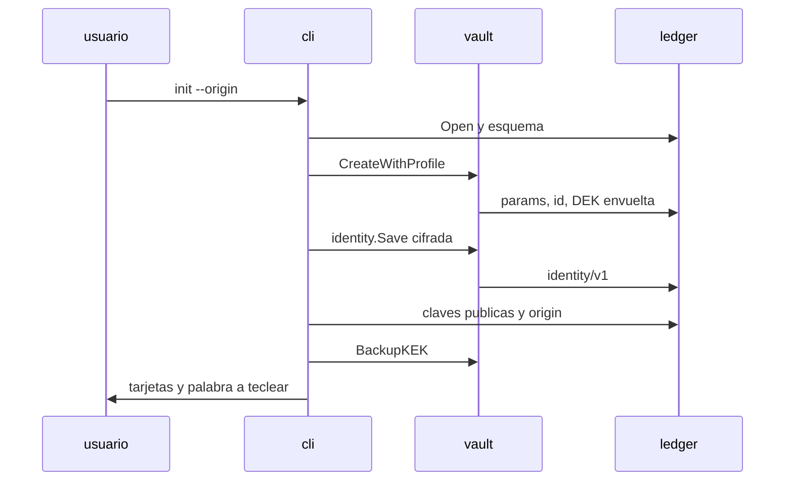

### 2.2 `seal` — sellar, con idempotencia y atomicidad (ADR-020)

`cmd/nucleo/seal.go#cmdSeal`:

1. Lee el documento con tope (`cmd/nucleo/limits.go#readLimited`) y, si se pide, aplica el
   perfil (`cmd/nucleo/profile.go#applyProfile`).
2. Resuelve la política (`cmd/nucleo/policy.go#policyFlags.resolve`) y abre el ledger
   verificándolo (`cmd/nucleo/env.go#env.openStoreWith`, §2.5).
3. Abre el vault y carga la identidad (`cmd/nucleo/env.go#env.unlock`) y exige que la cadena la
   firme esta clave (`cmd/nucleo/policy.go#checkChainSigner`).
4. **Idempotencia**: con `--idempotency-key`, busca un sellado anterior
   (`cmd/nucleo/idempotency.go#leerIdem`) y, si lo hay con el mismo documento, contesta lo del
   primero sin escribir (`cmd/nucleo/reseal.go#sealIdempotente`).
5. Con `--fail-on-stale` y la atestación vieja, no sella (`cmd/nucleo/stale.go#checkStaleness`,
   ADR-028).
6. Construye el bloque: `internal/ledger/block.go#NewHeader` sobre el último
   (`internal/store/blocks.go#Store.LastBlock`), comprueba el reloj
   (`cmd/nucleo/reloj.go#relojCoherente`) y lo firma (`internal/ledger/block.go#Seal`).
7. Cifra el contenido (`cmd/nucleo/reseal.go#contenidoParaSellar` →
   `internal/vault/blob.go#Vault.EncryptBlob`) y calcula los compromisos del perfil
   (`cmd/nucleo/profile.go#commitmentsDe`).
8. **Atomicidad**: bloque, blob, compromisos y registro de idempotencia, en **una**
   transacción (`internal/store/record.go#Store.AppendRecord`), que comprueba que el bloque
   encadena con el último dentro de la misma transacción. Si dos procesos sellan a la vez, el
   que pierde reintenta (`cmd/nucleo/reintento.go#sellarConReintentos`).
9. Juzga la frescura y registra la alarma si toca (`cmd/nucleo/reseal.go#sealTail`,
   `cmd/nucleo/alarma.go#registraAlarma`).

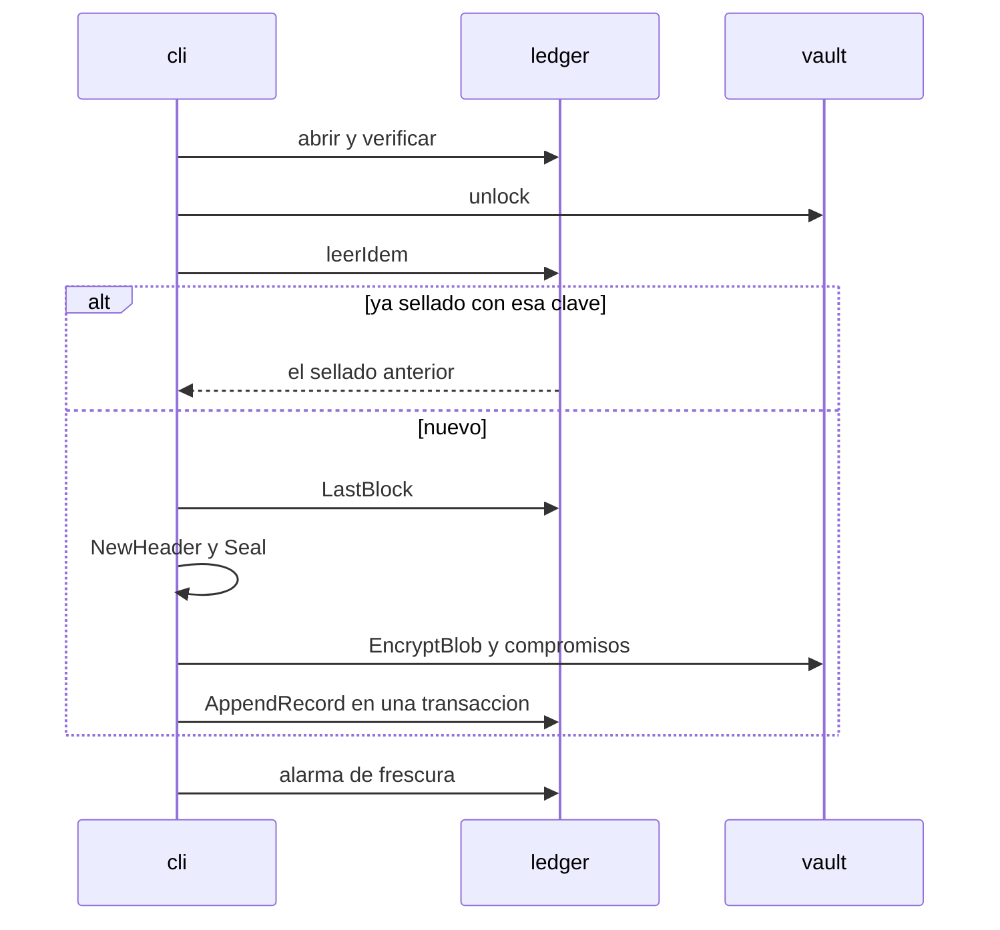

### 2.3 `sync` — pedir atestación a un testigo

`cmd/nucleo/sync.go#cmdSync`:

0. Antes de tocar la red, valida la URL del testigo (`cmd/nucleo/testigo_errores.go#validaURLDeTestigo`):
   una errata es un error de uso, no un incidente del testigo.
1. Elige el testigo: `cmd/nucleo/policy.go#policyFlags.resolveSync` (la política entera y
   `--witness-name`, o las banderas sueltas) y crea el cliente
   (`internal/witness/client.go#NewClient`).
2. Abre el ledger y el vault, como en `seal`.
3. `internal/logsync/logsync.go#SyncWithWitness` sobre `internal/logsync/adapter.go#StoreLog`:
   1. pregunta al testigo qué recuerda (`internal/logsync/logsync.go#remoteSize` →
      `internal/witness/client.go#Client.Checkpoint`, nota verificada contra su clave); si
      recuerda **más** de lo que hay en disco, es un rollback (`RollbackError`);
   2. firma el checkpoint del tamaño local (`internal/logsync/adapter.go#StoreLog.SignCheckpoint`
      → `internal/checkpoint/log.go#Log.Sign`, que antes de devolverlo deja la nota en
      `log/last-signed/v1` con `internal/store/checkpoints.go#Store.PutLastSigned`);
   3. le manda checkpoint y prueba de consistencia
      (`internal/witness/client.go#Client.AddCheckpoint`); un 409 con un tamaño mayor que el
      local también es rollback;
   4. comprueba que la cosignature cubre el estado local (`internal/logsync/logsync.go#coversLocalState`)
      y guarda la nota cosignada (`internal/logsync/adapter.go#StoreLog.RecordCosigned` →
      `internal/store/checkpoints.go#Store.PutCheckpoint`).
4. Con éxito, en este orden: si había un rollback registrado y el ledger ya lo cubre, lo borra
   (`internal/store/checkpoints.go#Store.ClearRollback`); después `Store.PutLastCosignature` y
   `Store.PutLastAttested`; y cierra la alarma si la había (`cmd/nucleo/alarma.go#cierraAlarma`).
5. Con rollback: lo deja escrito (`internal/store/checkpoints.go#Store.PutRollback`) y sale con 2.
   Con el testigo caído: explica el fallo (`cmd/nucleo/testigo_errores.go#errorDeTestigo`) y
   registra la alarma; sale con 3.

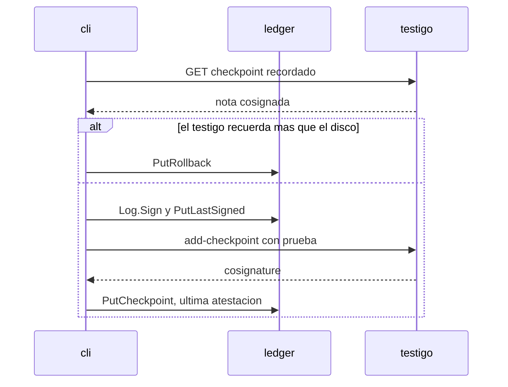

### 2.4 `receipt` — emitir un recibo

`cmd/nucleo/seal.go#cmdReceipt`:

1. Abre con la política y arma la del emisor (`cmd/nucleo/seal.go#issuerPolicy`).
2. **Abre el vault y carga la identidad** (`cmd/nucleo/env.go#env.unlock`): emitir un recibo
   **firma**, y la clave del firmante solo existe descifrada con la passphrase. Coteja el fichero
   de política con el ledger (`cmd/nucleo/policy.go#checkPolicyMatchesLedger`).
3. `internal/receipt/receipt.go#Issue` arma el recibo: el último checkpoint cosignado
   (`internal/store/checkpoints.go#Store.LastCheckpoint`), el bloque, las hojas
   (`internal/store/blocks.go#Store.LeafData`) y el camino de inclusión
   (`internal/ledger/merkle.go#InclusionProof`); rechaza una entrada no atestiguada. Y **lo firma
   ella misma** con la clave del emisor, destinatario incluido (ADR-015):
   `internal/receipt/format.go#Sign`, sobre los bytes de `internal/receipt/format.go#SignedBytes`.
   Esos bytes incluyen el texto legible, que lleva el tiempo demostrable; por eso la nota y el
   quórum de testigos ya se verifican aquí (`internal/receipt/receipt.go#Receipt.ProvableTime`), y
   una política que no alcanza el quórum falla al emitir.
4. `internal/receipt/format.go#Format` lo serializa, ya firmado.
5. **Lo verifica entero y solo después lo escribe** (`cmd/nucleo/seal.go#entregaRecibo`, §2.5 b):
   con `--out`, en un temporal que se renombra al nombre final. Un recibo que no verifica no
   llega al disco. (Hasta el Sprint 17 se escribía antes de verificar: hallazgo ALTO de la
   revisión del 2026-10-10.)

### 2.5 `verify` y la verificación de un recibo

**a) El ledger** (`cmd/nucleo/verify.go#cmdVerify`, y la apertura de todos los comandos):

- `cmd/nucleo/env.go#env.openStoreWith` abre **sin** política (`internal/store/store.go#Open`)
  o **con** ella (`internal/store/store.go#OpenWithWitnesses`). Las dos pasan por
  `internal/store/store.go#open`, que primero comprueba la regla de hoja
  (`internal/store/integrity.go#Store.checkLeafRule`) y después llama a
  `internal/store/integrity.go#Store.VerifyIntegrity`: la cadena, la continuidad del firmante y,
  **con política**, la atestación: el checkpoint guardado tiene que verificar bajo la política
  (`internal/store/integrity.go#Store.attestationState` → `internal/proof/proof.go#VerifyNote`).
  Sin política, un checkpoint guardado es «presente, NO verificado» (ADR-016).
- `--full`: `internal/store/integrity.go#Store.VerifyFull` recomputa todas las firmas.

**b) Un recibo**: la CLI no tiene un subcomando para verificar recibos ajenos; eso lo hacen los
verificadores de la contraparte. Los tres **comprueban las mismas propiedades**, pero no con el
mismo procedimiento: el orden difiere, y el de Go se detiene en el primer fallo
(`internal/receipt/format.go#Receipt.Verify` empieza por la firma del emisor), mientras que el de
PHP acumula los motivos de rechazo y sigue (`sdk/php/src/Verifier.php#Verifier::verify` empieza por
la identidad del firmante y termina comprobando que el texto legible es el que dice la prueba).
Lo que tiene que coincidir es el **veredicto**, y eso es lo que compara el diferencial. Qué
propiedad comprueba cada uno:

| paso | Go | TypeScript | PHP |
|---|---|---|---|
| entrada | `internal/receipt/format.go#Receipt.Verify` | `sdk/ts/src/receipt.ts#verifyReceipt` | `sdk/php/src/Verifier.php#Verifier::verify` |
| firma del emisor sobre el recibo | `internal/receipt/format.go#VerifyReceiptSignature` | dentro de `verifyReceipt` | dentro de `Verifier::verify` |
| firma del bloque y hoja `leaf/v2` | `internal/receipt/receipt.go#Receipt.VerifyBlockSignature` | dentro de `verifyReceipt`, con `sdk/ts/src/crypto.ts#verifyEd25519` | dentro de `Verifier::verify` |
| nota, firmas y quórum | `internal/proof/proof.go#VerifyNote` | dentro de `verifyReceipt`, con `sdk/ts/src/note.ts#parseNote` y `sdk/ts/src/cosignature.ts#parseCosignature` | dentro de `Verifier::verify`, con `sdk/php/src/Note.php#Note` y `sdk/php/src/Cosignature.php#Cosignature` |
| inclusión | `internal/ledger/merkle.go#VerifyInclusion` | `sdk/ts/src/merkle.ts#verifyInclusion` | `sdk/php/src/Merkle.php#Merkle::verifyInclusion` |

Que digan lo mismo lo comprueba el diferencial de tres vías (`sdk/ts/scripts/diferencial.mjs`,
con el catálogo de `internal/receipt/diferencial_test.go#TestDiferencialGeneraCatalogo`).

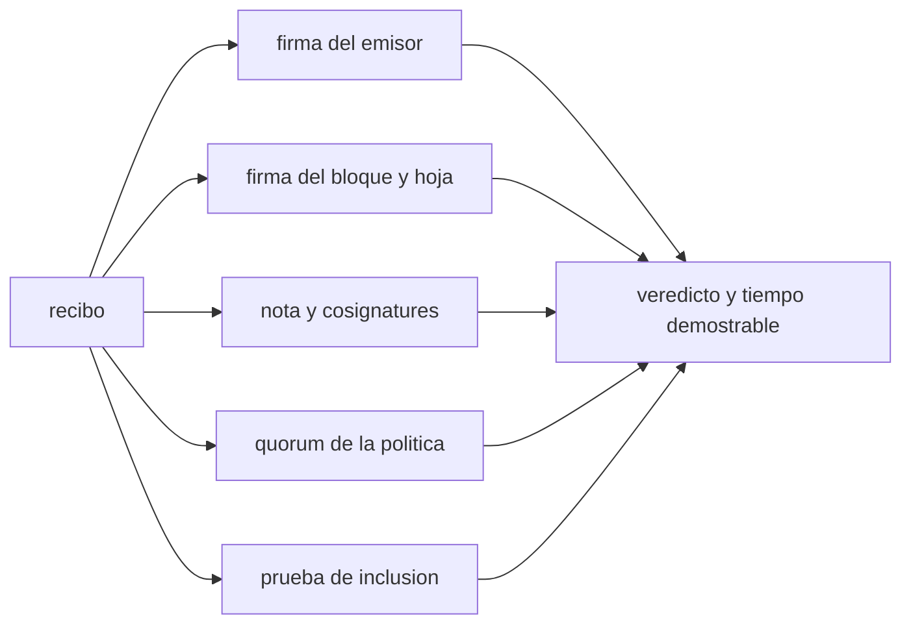

Las propiedades, sin orden: cada verificador las recorre a su manera.

### 2.6 `reconcile` — el sistema vivo contra lo sellado

`cmd/nucleo/reconcile.go#cmdReconcile` prepara la lectura del JSONL del sistema vivo
(`cmd/nucleo/reconcile.go#jsonlSource`, que lee a medida que se le pide) y
`internal/reconcile/reconcile.go#Reconcile` carga primero los bloques
(`internal/store/blocks.go#Store.Blocks`), después recorre los registros vivos comparando el hash
de cada uno con el `payload_hash` sellado y, salvo `--full=false` —está activado por omisión—,
añade `Store.VerifyFull`. Una comparación que no se
puede hacer no es un veredicto (ADR-022).

### 2.7 `restore --new-passphrase` (ADR-029)

`cmd/nucleo/backup.go#cmdRestore`:

1. Lee las tarjetas (`cmd/nucleo/backup.go#readShares`), reconstruye la KEK
   (`internal/vault/backup.go#RestoreKEK`) y comprueba que es la de este vault sin recibir la DEK
   (`internal/vault/keys.go#CheckKEK`).
2. Lee la passphrase nueva y prepara el cambio sin escribir: `internal/vault/rekey.go#PrepareRekey`
   (salt nuevo, mismos parámetros, misma DEK reenvuelta y comprobada).
3. Emite tarjetas nuevas (`internal/vault/backup.go#BackupKEK`), las enseña y pide la palabra
   (`cmd/nucleo/init.go#tecleaLaPalabra`). Si no coincide, no cambia nada.
4. Escribe salt y DEK juntos: `internal/vault/rekey.go#Rekey.Commit` →
   `internal/store/blobs.go#Store.ReplaceMeta`, una transacción que antes comprueba que las dos
   filas siguen como se leyeron.
5. Comprueba que la passphrase nueva abre (`internal/vault/keys.go#Unlock`).

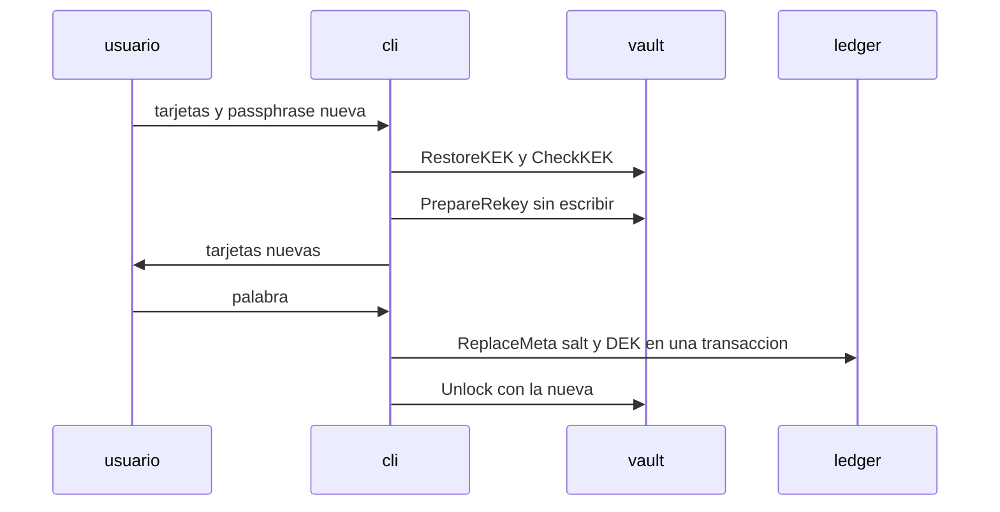

### 2.8 El testigo, de uno o de varios logs (ADR-030)

`cmd/nucleo/sync.go#cmdWitness`:

1. La configuración: `cmd/nucleo/sync.go#configDelTestigo` —el fichero de `--config`, leído con
   `cmd/nucleo/limits.go#readLimited` y `internal/witness/config.go#ParseConfig` (que usa
   `internal/estricto/estricto.go#Leer`), o un solo log con `--log-origin`/`--log-key`—.
2. La memoria y la clave: `internal/witness/state.go#OpenState` y `cmd/nucleo/sync.go#witnessKey`:
   una clave nueva se crea en exclusiva y en `0600`; una que ya existía se comprueba antes de usarla
   (`cmd/nucleo/keyperms_unix.go#checkKeyPerms`).
3. `internal/witness/witness.go#NewWithState` y `internal/witness/config.go#Config.Apply`:
   `internal/witness/witness.go#Witness.AddLog` por cada activo y
   `internal/witness/witness.go#Witness.RetireLog` por cada retirado.
4. Avisa de la memoria sin configurar (`cmd/nucleo/sync.go#memoriaSinConfigurar` →
   `internal/witness/state.go#PersistentState.Origins`).
5. Sirve: `internal/witness/server.go#Server.Handler`. Un `add-checkpoint` entra por
   `internal/witness/server.go#Server.addCheckpoint` (cuerpo acotado, parseado con
   `internal/witness/protocol.go#UnmarshalAddCheckpoint`) y llega a
   `internal/witness/witness.go#Witness.CosignAt` → `internal/witness/witness.go#Witness.cosign`,
   en este orden: el origin elige la clave —y un log retirado o desconocido se rechaza ahí—, la nota
   se verifica con ella (`internal/checkpoint/checkpoint.go#Verify`), el tamaño anterior declarado
   no puede superar al del checkpoint, y solo entonces, dentro de una transacción de la memoria
   (`internal/witness/state.go#PersistentState.Advance`), se compara con lo recordado
   (`internal/witness/witness.go#checkExtension`) y se cosigna
   (`internal/witness/cosignature.go#Signer.Sign`).

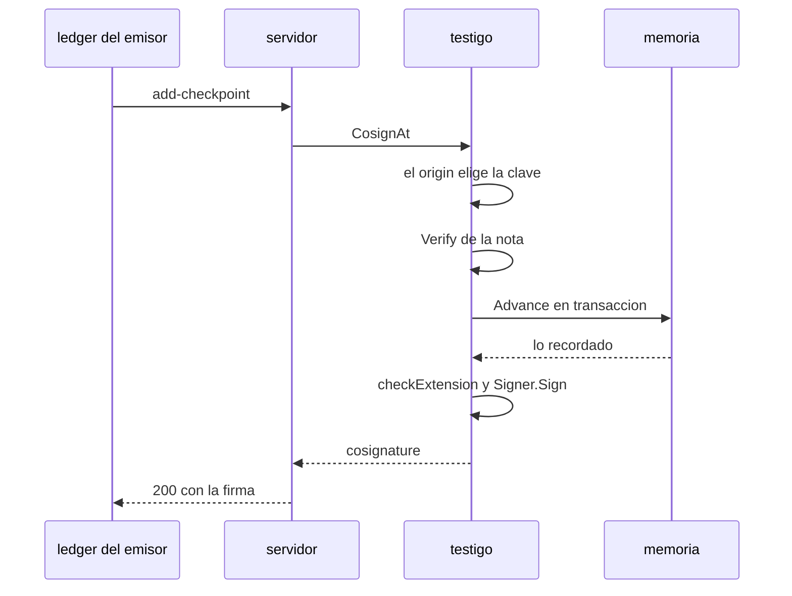

### 2.9 Retirar un log

1. El operador mueve el origin de `logs` a `retired` y reinicia el testigo.
2. `internal/witness/witness.go#Witness.RetireLog` comprueba que la memoria de ese log, si la
   hay, está firmada por la clave dada (enmienda de ADR-030); si no, `ErrRetiredKey` y el testigo
   no arranca.
3. Un `add-checkpoint` de ese origin acaba en `ErrRetiredLog`, que
   `internal/witness/server.go#Server.failCosign` convierte en un 404 con el cuerpo
   `internal/witness/server.go#RetiredBody`.
4. Del lado del emisor, `cmd/nucleo/testigo_errores.go#clasificaFalloDeTestigo` reconoce ese
   cuerpo y lo dice: el testigo dejó de cosignar este log.
5. La ruta de monitorización lo sigue publicando: `internal/witness/server.go#Server.monitorCheckpoint`
   encuentra el origin entre activos y retirados (`internal/witness/witness.go#Witness.originByHash`).

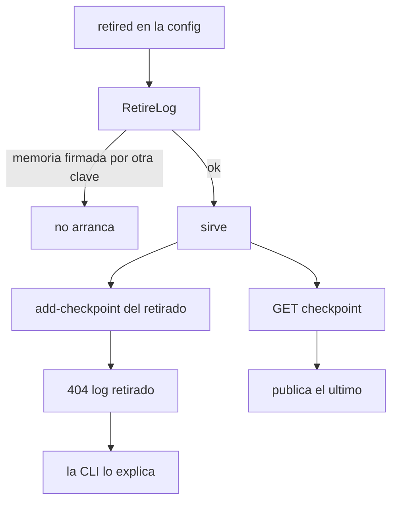

### 2.10 Testigo mutuo

No es un componente nuevo: dos instalaciones, cada una con su ledger y un testigo de varios logs
cuya configuración nombra el log de la **otra**. Lo ensaya de punta a punta
`scripts/ensayo-testigo-mutuo.sh` (job `testigo-mutuo` del CI): cada una sincroniza con el testigo
de la otra; si A restaura un respaldo viejo, el testigo de B lo detecta en el `sync` de A
(§2.3, rollback).

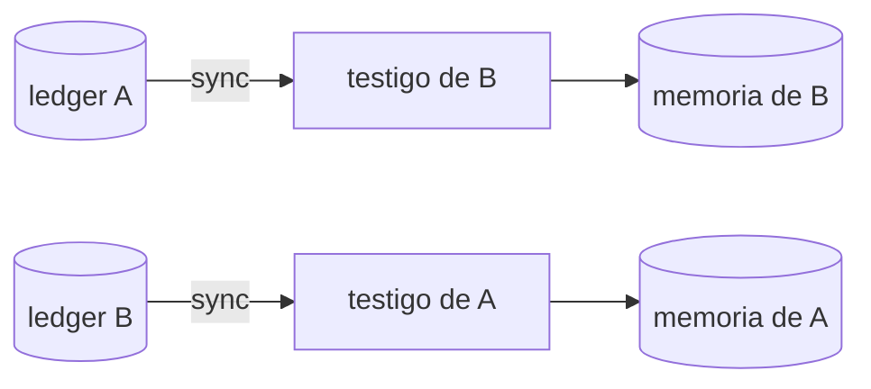

---

## 3. Fronteras de confianza

Lo que entra de fuera y quién lo comprueba antes de usarlo.

| entrada | viene de | la comprueba |
|---|---|---|
| **la política** | quien verifica; un fichero | `cmd/nucleo/policy.go#loadPolicyFile` (tope de tamaño y aviso de permisos) → `internal/policy/policy.go#Parse` (gramática estricta, ADR-018); en TypeScript `sdk/ts/src/policy.ts#parsePolicyText`, en PHP `sdk/php/src/Policy.php#PolicyReader`. Los tres pasan por `testdata/vectors/policy/` |
| **un recibo** | el emisor, a la contraparte | los tres verificadores de §2.5 b, con los vectores de `testdata/vectors/receipt/` y el diferencial |
| **un checkpoint del testigo** | la red | `internal/witness/client.go#Client.Checkpoint` y `internal/witness/client.go#Client.AddCheckpoint` verifican la cosignature contra la clave de la política (`internal/witness/client.go#Client.verifyCosigned`); `internal/logsync/logsync.go#coversLocalState` exige que cubra el estado local |
| **el cuerpo HTTP que recibe el testigo** | cualquiera | `internal/witness/server.go#Server.addCheckpoint` (tope `maxRequestBody`), `internal/witness/protocol.go#UnmarshalAddCheckpoint`, y `internal/witness/witness.go#Witness.cosign`: el origin solo elige la clave, la firma tiene que ser suya |
| **el fichero de configuración del testigo** | quien lo opera | `cmd/nucleo/sync.go#configDelTestigo` (tope y aviso de permisos, `cmd/nucleo/sync.go#avisoDePermisosDeConfig`) → `internal/witness/config.go#ParseConfig` |
| **la salida `--json`** | la CLI, para los SDK | es formato de cable (ADR-025, ADR-027): vectores en `testdata/vectors/cli-json/`, y la validan `sdk/php/src/Contract.php#Contract` y `examples/erp-node/src/contrato.js#sellado` |
| **el documento a sellar, la passphrase, las tarjetas** | quien invoca | `cmd/nucleo/limits.go#readLimited` (topes) y `cmd/nucleo/env.go#readPassphrase` |
| **el propio fichero del ledger** | el disco, que puede estar manipulado | `internal/store/integrity.go#Store.VerifyIntegrity` en cada apertura; con política, la atestación y el firmante se verifican contra claves que no salen del fichero (ADR-016, ADR-017) |

---

## 4. Estados persistentes

### 4.1 El ledger: `nucleo.db` (`internal/store/schema.go#schemaSQL`)

| tabla | qué guarda | quién escribe | mutable |
|---|---|---|---|
| `blocks` | la cadena de bloques firmados | `seal` (`internal/store/record.go#Store.AppendRecord`) | **append-only**: triggers `blocks_no_update` y `blocks_no_delete` |
| `blobs` | el contenido cifrado de cada documento | `seal` (`AppendRecord`) | sin UPDATE (trigger `blobs_no_update`); **sí** DELETE —la supresión, `internal/store/blobs.go#Store.DeleteBlob`—, que hoy solo llama la biblioteca (`internal/vault/erase.go#EraseBlob`), ningún comando |
| `checkpoints` | las notas cosignadas, una por tamaño | `sync` (`internal/store/checkpoints.go#Store.PutCheckpoint`) | **append-only**: triggers `checkpoints_no_update` y `checkpoints_no_delete` |
| `vault_meta` | clave → valor, mutable por diseño | ver abajo | sí |
| `log_state` | clave → valor, mutable por diseño | ver abajo | sí |

Claves de `vault_meta`:

| clave | qué es | la escribe |
|---|---|---|
| `vault/params/v1`, `vault/id/v1`, `vault/dek/v1` | parámetros de Argon2id con su salt, el id del vault, la DEK envuelta (`internal/vault/keys.go#MetaParamsKey`) | `init`; `restore --new-passphrase` cambia params y DEK juntos (`Store.ReplaceMeta`) |
| `identity/v1` | las claves privadas, cifradas con la DEK (`internal/identity/identity.go#MetaKey`) | `init` |
| `log/pubkey/v1`, `log/origin/v1`, `log/signer-pubkey/v1` | lo público del log, en claro (`internal/store/integrity.go#MetaLogPubKey`) | `init` |
| `log/leaf-rule/v1` | la regla de hoja del log (`internal/store/integrity.go#MetaLeafRuleKey`) | la primera apertura (`Store.checkLeafRule`) |
| `commit/v1/<payload_hash>` | los compromisos del perfil (`cmd/nucleo/profile.go#metaCommitPrefix`) | `seal --profile`, dentro de `AppendRecord` |

Claves de `log_state`:

| clave | qué es | la escribe |
|---|---|---|
| `log/last-signed/v1` | el último checkpoint firmado: el cerrojo que impide firmar dos raíces para el mismo tamaño (`internal/store/checkpoints.go#LastSignedKey`) | `sync`, vía `Log.Sign` |
| `log/last-cosignature/v1`, `log/last-attested/v1` | el último contacto verificado con un testigo (`internal/store/checkpoints.go#LastCosignatureKey`, `internal/store/checkpoints.go#LastAttestedKey`) | `sync` |
| `log/rollback-detected/v1` | un rollback detectado, hasta que un `sync` lo resuelva (`internal/store/checkpoints.go#RollbackKey`) | `sync` (lo pone y lo borra) |
| `log/stale-alarm/v1` | la alarma de frescura (`internal/store/checkpoints.go#StaleAlarmKey`, ADR-028) | `seal`, `status`, `verify`, `reconcile`, `sync` (`cmd/nucleo/alarma.go#registraAlarma`) y `alert ack` (`cmd/nucleo/alert.go#cmdAlertAck`) |
| `seal/idempotency/v1/<hash>` | el registro de cada clave de idempotencia (`cmd/nucleo/idempotency.go#idemPrefix`) | `seal --idempotency-key`, dentro de `AppendRecord` |

### 4.2 El testigo: `testigo.db` y `testigo.db.key`

| dónde | qué guarda | quién escribe | mutable |
|---|---|---|---|
| tabla `witness_logs` (`internal/witness/state.go#PersistentState`) | por cada origin, la nota del último checkpoint que cosignó | `witness serve`, en cada cosignature (`PersistentState.Advance`, en una transacción) | sí, una fila por origin que solo avanza; retirar un log **no** la borra |
| `testigo.db.key` | la clave privada del testigo, `0600` | la primera vez que arranca o que se pide `witness key` (`cmd/nucleo/sync.go#witnessKey`, creación exclusiva) | no: se crea una vez |
| la configuración | qué logs atiende y cuáles están retirados | quien opera el testigo; el testigo solo la lee | — |

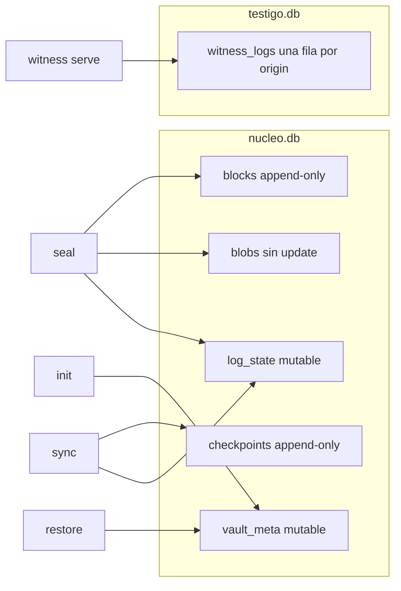
